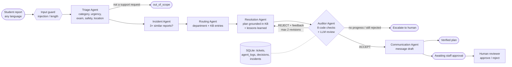

# UniResolve AI

[](https://github.com/soofiyevv/hackaton2026/actions/workflows/tests.yml)

**A multi-agent system that turns University of Debrecen students' campus problems into verified, actionable resolution plans, with an independent AI auditor that rejects weak answers, forces revisions and escalates to staff when needed.**

Track: **Autonomous Agents & Intelligent Systems** - GDG Debrecen Agentic AI Hackathon 2026. Built on 21 November 2026.

**Team Caucasus:** Kanan Sofiyev (backend, agents, orchestration) · Aslan Shtancaev (frontend, UX)

## How it works



- **Incident Agent**: when 3+ students report the same problem at the same place within an hour, it groups them into one campus incident and raises the priority.
- **Learns from its auditor**: the most frequent past rejection reasons are fed into every new plan ("lessons learned"), so the same mistake becomes less likely.
- **Communication Agent** drafts the message to the responsible office; code checks block invented contacts and invented "I already tried..." claims.
- **Human in the loop**: staff approve or reject cases that need a decision; prompt-injection and off-topic input are detected.
- Real agent loop in code (`backend/orchestrator.py`): the auditor's feedback is passed back into the resolver's next prompt.
- The auditor combines deterministic checks (unknown KB references, invented contact details, ignored urgency, ignored exam, missing safety guidance...) with an LLM review. A plan is accepted only if both agree.
- Model fallback chain across Groq (gpt-oss-120b / 20b) and Gemini (3.5 / 3.8 flash), then offline simulation (auto mode). Light agents use a fast model so the strong model's rate limit is kept for planning and auditing. Every agent call records which provider answered; simulated output is always labelled.
- Knowledge base of 20 university support areas (IT, facilities, exams, administration, finance, wellbeing, health, accessibility, harassment, housing, library, canteen, lost & found, sports, transport...) in `backend/knowledge_base.json`. It is **demo data**, not official university information.
- The system produces plans. It does not physically fix anything and does not invent success metrics.

## Run it

```bash
pip install -r requirements.txt
cp .env.example .env            # add GEMINI_API_KEY and/or GROQ_API_KEY
python demo/run_demo.py         # console demo of all scenarios (live LLM)
python demo/run_demo.py --offline
python -m pytest -q             # offline tests
python demo/evaluate.py         # 20 labelled cases on the live LLM -> data/eval_report.md
streamlit run frontend/app.py   # web UI
```

Windows: use `copy .env.example .env`.

## Evaluation

See `data/eval_report.md` (generated by `demo/evaluate.py` on 20 hand-labelled problems: routing accuracy, first-attempt acceptance, self-corrections, escalations, latency).

## Repository

| path | owner | content |
|---|---|---|
| `backend/` | backend | agents, orchestrator, LLM layer, knowledge base, SQLite |
| `frontend/` | frontend | Streamlit UI |
| `demo/run_demo.py` | backend | console demo |
| `tests/` | backend | pytest |
| `BACKEND_CONTRACT.md` | backend | interface between backend and frontend |

## Tools, APIs and AI assistants used

- **Groq API** (`groq` SDK) - openai/gpt-oss-120b and gpt-oss-20b for the agents
- **Google Gemini API** (`google-genai` SDK) - gemini-3.5-flash / 3.8-flash as fallback models
- **Streamlit** - web UI
- **SQLite** (Python standard library) - persistence
- **python-dotenv**, **pytest**
- **AI assistants:** Claude (Anthropic) helped write and review the backend code and documentation. <!-- add any others you used, e.g. ChatGPT/Copilot for the frontend -->
